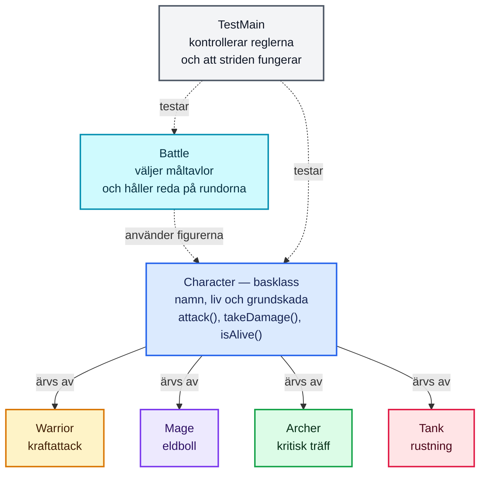
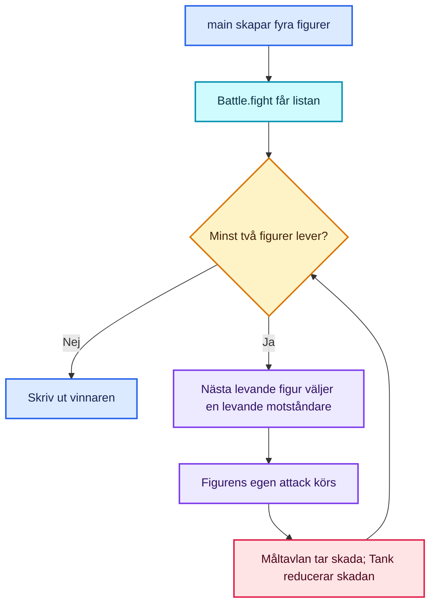

# OOP Battle Royale

Ett litet Battle Royale-spel i Java som körs i terminalen. Fyra figurer slåss. Varje levande figur attackerar en slumpmässigt vald motståndare, och den sista som fortfarande lever vinner.

Projektet visar grundläggande objektorienterad programmering (OOP): klasser och objekt, inkapsling, arv, overriding och polymorfism.

## Krav

- Java 17 eller senare
- Terminal, IntelliJ IDEA eller en annan Java-utvecklingsmiljö
- Git och ett GitHub-konto om du vill publicera projektet

## Kör programmet

Öppna terminalen i projektmappen och kör:

```bash
mkdir -p out
javac -d out src/Main.java
java -cp out Main
```

I IntelliJ IDEA kan du också öppna projektet och köra `Main`.

Varje körning kan få ett annat resultat eftersom attacker och måltavlor väljs slumpmässigt.

## Tester

Testerna finns i `test/TestMain.java`. De använder bara Java, så du behöver inte installera JUnit eller lägga till några bibliotek.

Kör testerna från projektets rotmapp:

```bash
mkdir -p out
javac -d out src/Main.java test/TestMain.java
java -cp out TestMain
```

Du ska se sex rader som börjar med `PASS:` och till sist:

```text
All 6 tests passed.
```

Testerna kontrollerar att:

1. Alla fyra figurtyper börjar med rätt mängd HP.
2. Skada minskar HP, HP går inte under noll och en besegrad figur inte kan skadas vidare.
3. Varje figurtyp gör skada inom sitt förväntade intervall. Eftersom skadan är slumpmässig kontrollerar testet intervallet, inte ett enda exakt tal.
4. Tankens rustning minskar skada och negativ skada ändrar inte HP.
5. Striden avvisar en null-lista, en tom lista eller en lista med färre än två figurer.
6. En strid med testfigurer som alltid gör förutsägbar skada avslutas med en vinnare.

Testerna använder egna hjälpfunktioner som avbryter med ett tydligt fel om ett villkor inte stämmer. Det gör att testerna fungerar utan ett separat testbibliotek. Testutskrifter från själva striderna fångas upp så att testresultatet blir lättare att läsa.

I IntelliJ IDEA är `test` markerad som testkod i projektets `.iml`-fil. Om projektet inte uppdateras automatiskt: högerklicka på mappen `test`, välj **Mark Directory as → Test Sources Root**, och kör sedan `TestMain` med gröna körknappen.

## Så fungerar programmet, från början till slut

Tänk på spelet som ett brädspel: först ställer vi upp spelarna, sedan väljer de måltavlor och turas om att slåss. När bara en spelare står kvar avslutas spelet.

### 1. Java läser in programmet

All kod finns i `src/Main.java`. Filen har en publik klass som heter `Main` och flera andra klasser. I Java får flera klasser finnas i samma fil, men den publika klassen ska ha samma namn som filen.

Importerna högst upp gör färdiga Java-verktyg tillgängliga:

- `ArrayList` och `List` används för att hålla ordning på deltagarna.
- `Random` används för slumpmässiga attacker och måltavlor.

### 2. `main` startar spelet

Java börjar köra här:

```java
public static void main(String[] args)
```

`main` skapar fyra objekt: en `Warrior`, en `Mage`, en `Archer` och en `Tank`. De sparas tillsammans i en lista av typen `List<Character>`.

Det är viktigt att listan kan innehålla `Character`: alla fyra figurerna **är** en sorts `Character`, eftersom de ärver från den klassen. Till sist skickas listan till `Battle.fight(fighters)`.

### 3. `Character` beskriver det som alla figurer delar

`Character` är en abstrakt basklass. Den håller den gemensamma informationen:

- `name`: figurens namn.
- `health`: hur mycket liv figuren har kvar.
- `maxHealth`: figurens liv från början.
- `attackDamage`: figurens grundskada.

Fälten är privata för att andra klasser inte ska kunna ändra dem hur som helst. Metoder som `getHealth()` låter andra delar av programmet läsa värden på ett kontrollerat sätt. Det är ett exempel på **inkapsling**.

Klassen har också gemensamma metoder:

- `takeDamage(damage)` minskar livet, men aldrig under noll, och skriver ut resultatet.
- `isAlive()` svarar om livet är större än noll.
- `canAttack(target)` kontrollerar att angriparen och måltavlan lever och att de inte är samma figur.
- `randomDamage(minimum, maximum)` väljer ett slumpmässigt heltal mellan gränserna, inklusive båda.

Metoden `attack(target)` är abstrakt: basklassen säger att varje figur måste kunna attackera, men varje underklass bestämmer själv hur attacken fungerar.

### 4. Underklasserna gör figurerna olika

`Warrior`, `Mage`, `Archer` och `Tank` är underklasser till `Character`. Det kallas **arv**. Varje konstruktor skickar startliv och grundskada till basklassen med `super(...)`.

Alla underklasser skriver sin egen version av `attack(...)`. Det kallas **overriding**. Märket `@Override` ber Java kontrollera att metoden verkligen ersätter en metod från basklassen.

- **Warrior** har 145 HP och kan få en kraftattack med 30 % chans.
- **Mage** har 105 HP och kastar en eldboll med varierande skada.
- **Archer** har 115 HP och kan få en kritisk träff med 25 % chans. En kritisk träff gör dubbel skada.
- **Tank** har 175 HP och reducerar inkommande skada med 7 tack vare rustning. Tankens overriding av `takeDamage(...)` visar att även andra metoder än attack kan ändras i en underklass.

### 5. `Battle.fight` genomför striden

Stridssystemet kontrollerar först att listan innehåller minst två deltagare. Sedan skrivs deltagarna ut.

En `while`-loop upprepar rundorna så länge fler än en figur lever. I varje runda:

1. Programmet går igenom deltagarna i listan.
2. En figur som är död får inte attackera.
3. Programmet samlar ihop de levande motståndarna.
4. `Random` väljer en av motståndarna.
5. Den aktiva figuren anropar `attack(target)`.
6. När bara en figur återstår avslutas striden och vinnaren skrivs ut.

Om en attack besegrar en figur sätts dess HP till noll. Den hoppar över sin tur när programmet kommer till den.

### 6. Här syns polymorfismen

Listan har typen `List<Character>`, men innehåller flera olika sorters objekt. När striden gör:

```java
attacker.attack(target);
```

anropar Java rätt implementation beroende på vilket objekt `attacker` faktiskt är. En `Warrior` använder sin attack, en `Mage` sin, och så vidare. Att samma anrop fungerar olika för olika objekttyper kallas **polymorfism**.

## Diagram

### Klassöversikt

Det här klassöversiktsdiagrammet använder ljusa färger för att skilja basklassen, de olika figurerna och stridssystemet åt. Pilarna visar arv: varje figur bygger på `Character`. `Battle` använder figurerna för att genomföra striden.



### Diagram över stridsflödet



## Mappar och filer

```text
oop-battle-royale/
├── README.md
├── test/
│   └── TestMain.java
└── src/
    └── Main.java
```

`out/` skapas när du kompilerar programmet. Den mappen är byggresultat och ska inte läggas upp på GitHub. `.gitignore` ser till att Git ignorerar `out/`.

## Ladda upp projektet till GitHub

### 1. Skapa ett tomt GitHub-repository

På GitHub väljer du **New repository**. Ett lämpligt namn är `oop-battle-royale`. Välj om projektet ska vara Public eller Private. Skapa helst repositoryt utan automatisk README, eftersom du redan har en lokalt.

### 2. Kontrollera projektmappen

Kör kommandona från projektets rotmapp:

```bash
git status
```

Lägg till projektfilerna:

```bash
git add README.md src/Main.java test/TestMain.java .gitignore oop-battle-royale.iml
```

Kontrollera vad som är på väg att läggas till:

```bash
git status
```

`oop-battle-royale.iml` hjälper IntelliJ att känna igen testmappen. IntelliJ-inställningar i `.idea/` behövs normalt inte för att kompilera spelet; kontrollera att till exempel `workspace.xml` och din lokala JDK-inställning inte läggs till av misstag.

### 3. Skapa en commit

En **commit** är en sparad version av dina ändringar. För den här versionen kan du skriva:

```bash
git commit -m "Add OOP Battle Royale game, tests, and documentation"
```

Commit-meddelandet är en kort rubrik. En bra rubrik börjar ofta med ett verb och berättar vad ändringen gör.

Om Git säger att din identitet saknas kan du ställa in namn och e-post för commits:

```bash
git config --global user.name "Ditt namn"
git config --global user.email "din-github-epost@example.com"
```

Använd gärna den privata GitHub-e-postadress som GitHub visar i **Settings → Emails**.

### 4. Koppla projektet till GitHub och skicka upp det

Byt ut `DITT-ANVÄNDARNAMN` mot ditt GitHub-användarnamn:

```bash
git branch -M main
git remote add origin https://github.com/DITT-ANVÄNDARNAMN/oop-battle-royale.git
git push -u origin main
```

Om kommandot säger att `origin` redan finns, kontrollera adressen med `git remote -v` i stället för att lägga till den igen. GitHub kan be dig logga in eller använda en token.

Efter uppladdningen öppnar du repository-sidan på GitHub och kontrollerar att `README.md` visas och att diagrammen renderas.

## Förslag på GitHub-beskrivning

**Repository description:**

> A beginner-friendly Java Battle Royale game demonstrating OOP, inheritance, overriding, polymorphism, and random combat.

**Om du vill skriva beskrivningen på svenska:**

> Ett enkelt Battle Royale-spel i Java som visar OOP, arv, overriding, polymorfism och slumpmässig strid.

GitHub-beskrivningen är den korta texten under repositoryts namn. Den är inte samma sak som README-filen.

## Dela projektet till GitHub från IntelliJ IDEA

Innan du börjar, kontrollera att projektet fungerar genom att köra både `Main` och `TestMain`. Kontrollera också att GitHub-kontot är anslutet i IntelliJ via **Settings/Preferences → Version Control → GitHub**. Menynamn kan skilja sig lite mellan IntelliJ-versioner.

1. Öppna projektet i IntelliJ IDEA. Öppna **Git → GitHub → Share Project on GitHub**. I vissa versioner finns delningen under **VCS → Share Project on GitHub**. Om IntelliJ frågar vilket konto som ska användas väljer du ditt anslutna GitHub-konto.
2. I delningsfönstret skriver du repository-namnet, till exempel `oop-battle-royale`.
3. I **Description** kan du skriva: `A beginner-friendly Java Battle Royale game demonstrating OOP, inheritance, overriding, polymorphism, and random combat.`
4. Om fönstret har fältet **Commit message** eller **Initial commit message**, skriv: `Add OOP Battle Royale game, tests, and documentation`. Det är rubriken för den första sparade versionen, inte beskrivningen av GitHub-repositoryt.
5. Välj om repositoryt ska vara privat eller publikt. Välj Public om klassen ska kunna se det via en länk; välj Private om bara du och inbjudna personer ska kunna se det.
6. Innan du delar, granska filerna som ska skickas. Ta med `README.md`, `.gitignore`, `src/Main.java` och `test/TestMain.java`. Ta gärna med `oop-battle-royale.iml` så IntelliJ känner igen testmappen. Ta inte med `out/`, `.idea/workspace.xml` eller personliga IDE-inställningar.
7. Klicka på **Share**. IntelliJ skapar repositoryt på GitHub och skickar upp den första versionen. Om det sedan visas ett fönster med **Commit** och **Push**, kontrollera filerna, skriv commit-meddelandet ovan och välj **Commit and Push** (eller **Commit**, följt av **Push**).
8. När IntelliJ visar att delningen lyckades öppnar du GitHub-länken. Kontrollera att källkod och tester finns där och att README:n visas. Kör gärna testerna lokalt igen efteråt.

Om GitHub visar att repository-namnet redan används, välj ett annat namn eller kontrollera att du inte redan har skapat repositoryt. Om uppladdning misslyckas på grund av inloggning, kontrollera GitHub-kontot i IntelliJ under **Settings/Preferences → Version Control → GitHub**.

## Möjliga nästa steg

När du förstår grunderna kan du prova att lägga till en Healer med en heal-förmåga, tester för `takeDamage()` och `isAlive()`, eller dela upp klasserna i separata filer. Nästa större steg mot full stack är att bygga ett API eller ett webbgränssnitt som använder spelreglerna.
