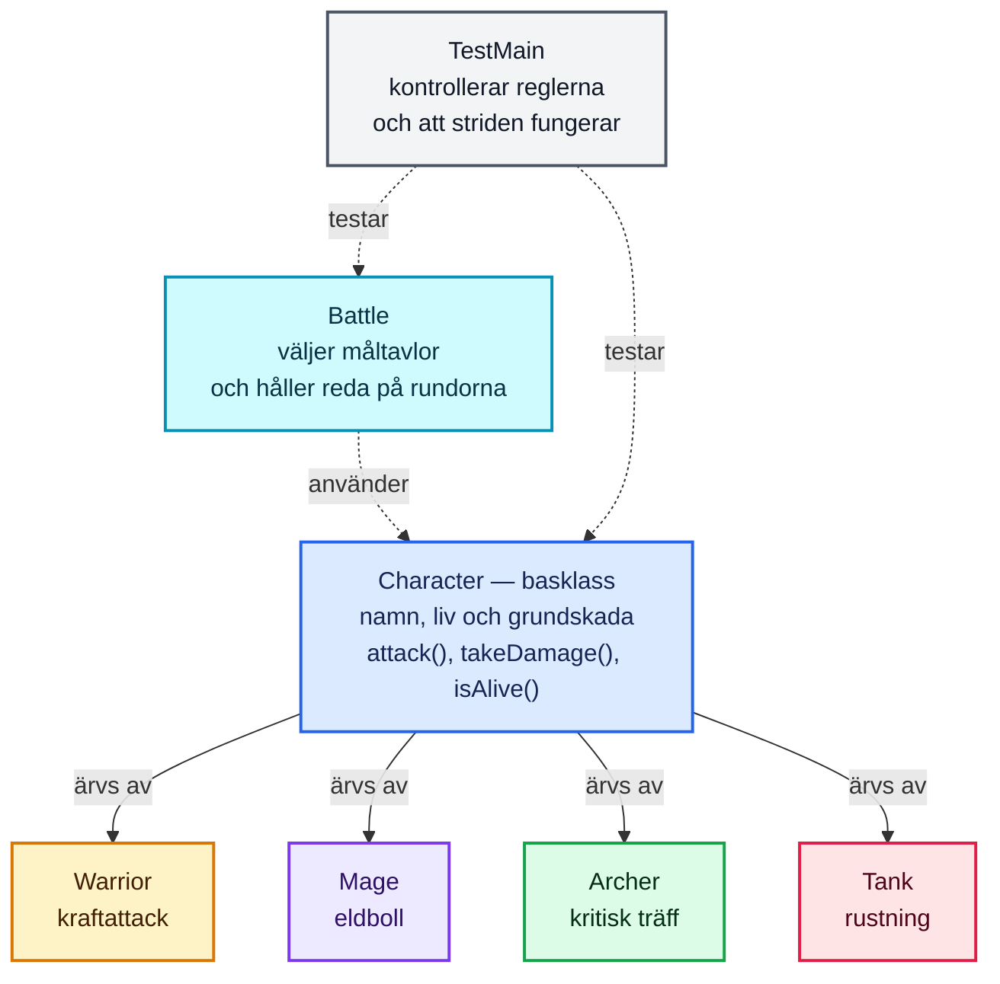
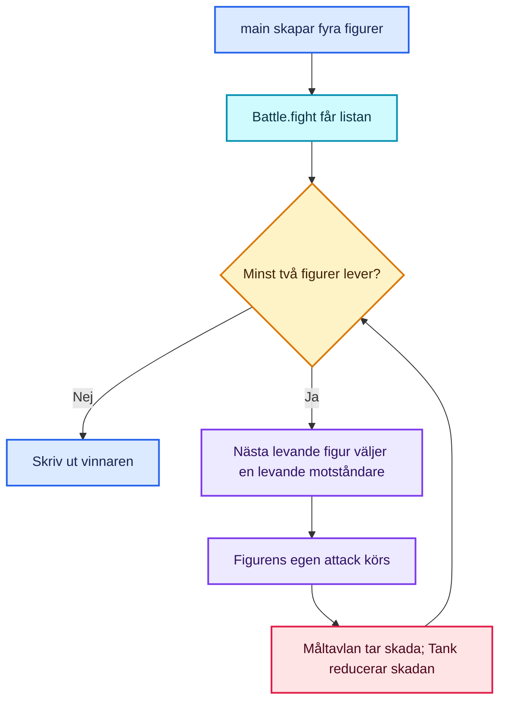

# OOP Battle Royale

Ett litet terminalspel i Java där fyra figurer slåss tills bara en återstår. Projektet demonstrerar objektorienterad programmering med arv, overriding och polymorfism.

## Figurer

| Figur | HP | Egenskap |
|---|---:|---|
| Warrior | 145 | Kan göra en kraftattack |
| Mage | 105 | Kastar en eldboll med varierande skada |
| Archer | 115 | Har chans till en kritisk träff |
| Tank | 175 | Rustning minskar inkommande skada |

Måltavlor och vissa attackeffekter väljs slumpmässigt, så striden kan få olika resultat vid varje körning.

## Krav

- Java 17 eller senare

## Kör spelet

Kör kommandona från projektets rotmapp:

```bash
mkdir -p out
javac -d out src/Main.java
java -cp out Main
```

I IntelliJ IDEA kan du också köra `Main`.

## Kör testerna

Testerna använder bara Java och kräver inget separat testbibliotek:

```bash
mkdir -p out
javac -d out src/Main.java test/TestMain.java
java -cp out TestMain
```

Testerna kontrollerar startliv, skada, besegrade figurer, attackernas skadeintervall, Tanks rustning, ogiltiga strider och att en strid kan få en vinnare. Ett lyckat testresultat avslutas med `All 6 tests passed.`

## OOP i projektet

- **Inkapsling:** `Character` håller namn och hälsa privata och ger kontrollerad åtkomst via metoder.
- **Arv:** `Warrior`, `Mage`, `Archer` och `Tank` ärver från `Character`.
- **Overriding:** Varje figur har sin egen version av `attack()`. `Tank` ändrar också `takeDamage()`.
- **Polymorfism:** Striden arbetar med en lista av typen `List<Character>`. När `attack()` anropas väljer Java implementationen som hör till det faktiska objektet.

## Klassöversikt

Varje färg representerar en klass. Pilarna från `Character` visar arv; streckade pilar visar att `Battle` och `TestMain` använder eller testar spelets klasser.



## Stridens flöde



## Projektstruktur

```text
oop-battle-royale/
├── README.md
├── src/
│   └── Main.java
└── test/
    └── TestMain.java
```

Kompilerade `.class`-filer sparas i `out/`. Det är byggresultat som kan återskapas från källkoden; `.gitignore` gör att Git inte behöver lägga upp dem.
